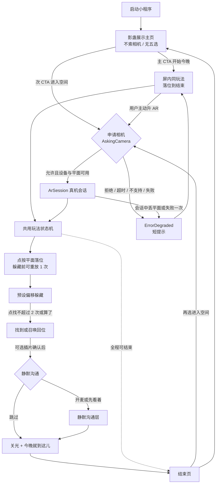

# 眠语 Demo 第一节点 · AR 入口与操作路径

- **作者**：CMQ-CIO-UX · 交互协同
- **写成时间**：2026-11-12 21:39（Asia/Shanghai）
- **本文件路径**：`/workspace/mianyu-demo/20261112-node1/ar-entry-path.md`
- **交验收对象**：CMQ-CIO · 信息与数字化（第一次验收）
- **状态**：文档已第一次验收通过，不等于 Demo 完成
- **本轮性质**：按**最终 AR 产品**设计的入口与操作路径，不是按「仅静态展示」裁剪后的简化版。但本文本身是设计文档：静态原型只应**照着示意**这条路径，**不**接真机相机、**不**宣称已做到可上架小程序 AR。初版仅静态，**未**建 GitHub 仓，**未**改历史 Notion 页。
- **修订**：2026-11-12 21:41（Asia/Shanghai）补齐与同目录刚落盘的 [`architecture.md`](./architecture.md) 的对齐说明；不改他人文件。
- **修订**：2026-11-12（Asia/Shanghai）按 CIO 对静默沟通必演示段与影盏收尾示意的裁定修订。
- **修订**：2026-11-12（Asia/Shanghai）按 CIO 转达的影盏一次收尾锁定，将等待锁表述改为已锁定；不改写 2026-11-07 Notion 定稿。
- **修订**：2026-11-12（Asia/Shanghai）按第一次验收记录，将落位可重放与主页次 CTA 从「仍待验收说明」改为本节点原型默认。

配套文件：同目录 [`ux-ia-flow.md`](./ux-ia-flow.md)（信息架构、画面、状态机、文案）。技术限制以同目录 [`ar-limitations.md`](./ar-limitations.md) 为准，本文不另开一份限制表，只把限制落实到入口决策与失败回退。

用词锁定：首展 IP 为「**影盏**」；历史先通角色为「**霁霁**」。不用「影盎」「雲雲」「雾雾」。

---

## 0. 本文写什么、不写什么

本文给出：从小程序启动到结束的入口决策树；相机 / 麦克风的申请时机与拒绝后果；屏内降级如何保持同一套状态机；AR 场景中影盏的落位与贴墙 / 坐靠蹲约束；失败如何回退。

本文不写：渲染栈在官方 xr-frame 与官方 three 之间如何二选一（`ar-limitations.md` 已标明本轮未锁死）；不编造未读到的接口字段名或未核实工期；不把公开路径可立项写成已经真机验证。

与 `ar-limitations.md` 的对齐点（写成时该稿已在同目录，2026-11-12 21:37 Asia/Shanghai）：

- 推荐主路径：**屏内先通 → 再升 AR → 失败或拒绝则降级回屏内同玩法**。
- **升 AR 再问相机**，不把相机权限挡在第一次进入之前。
- 失败不卡在权限页，不另开第二种玩法。
- VisionKit **V1** 点按平面落位；零第三方 AR SDK。
- 躲藏用预设静音偏移 + 淡出 / 半透明意象，不是真遮挡。
- 结束页不自动「再来一局」。
- 真遮挡、人体跟随、暗房满血 6DoF、台卡 Marker 必达，本版不做。
- 弱光 / 白桌 / 安卓漂移 / 本账号相机审核 / 全机型兼容：**有路径尚未真机验证，不得写成保证**。

差异与补对齐（不掩盖）：

- `ar-limitations.md` §2.1 不把开麦静默沟通写成已进入本轮必做工程包。**CIO 已裁定**（2026-11-12，约 21:40 后，Asia/Shanghai）：本节点静态原型必演示该段（仅 `after_find`，可跳过、可关麦、无 TTS，拒麦不中断躲猫猫闭环）；不得写成已实现开麦听懂；不回改 CFO P0 原文。
- 同目录 [`architecture.md`](./architecture.md)（2026-11-12 21:40 Asia/Shanghai）已对齐：只接影盏、无五选、屏内先通再升 AR、失败回屏内同玩法、主路径含找到后静默沟通（可跳过）、`anytime_after_place` 不上线、十态仅为收口摘述。影盏收尾：**已锁定**（2026-11-12，Asia/Shanghai，CIO 窗口；架构稿 §4.3 亦不代为裁定）：采用组合——找到后可选「插片确认」（可跳过），结束为「关光」。本节点静态原型按该已锁定组合执行；界面不再标「收尾示意，待立项锁定」，可保留「本节点按用户已锁定的组合收尾」。不改写 2026-11-07 Notion 定稿。入口微调：架构稿进入后先走屏内再升 AR；本文主路径相同，主页另保留次 CTA「进入空间」（用户主动才问相机）。**CIO 已裁定（本节点原型默认）**：推荐仍是屏内先通，不强制必须先打完一局屏内才能升 AR；升 AR 仍须用户主动，相机仅用户主动点选后才问。

---

## 1. 入口决策树（本轮锁定）

进入小程序后先到**影盏展示主页**，不先索相机，不出五选。主 CTA「开始今晚」走屏内（对齐「屏内先通」）。次 CTA「进入空间」或屏内局中 / 结束页的升 AR，才请求相机。拒绝、失败、不支持、丢平面，都回屏内同一套状态机。

这条树按最终 AR 产品书写：允许从主页直接升 AR，也允许先走完屏内再升。推荐默认是后者，以免用户一进来就被权限页拦住。CFO 底稿曾写「先问相机或先屏内」；本轮**不**把「先问相机」当作默认入口，理由与 `ar-limitations.md` §2.2 相同：拒相机或环境未就绪时不能卡死。拒相机仍须能走完同一套玩法，这与 CFO 验收底线相容。

---

## 2. 逐步操作路径

下列步骤同时适用于「最终产品应如何走」和「静态原型应如何示意」。原型用画面切换模拟权限与成败分支，不调用真相机 / 真麦克风 API。画面 ID 与 `ux-ia-flow.md` §3 一致。

### 2.1 启动到主页

1. 用户从微信打开小程序（本轮 Demo 壳，只接影盏）。
2. 可选极短启动过渡（S0），立即进入影盏展示主页（S1）。
3. 主页不申请任何权限。展示影盏坐 / 靠 / 蹲的暖琥珀侧影，禁止飘浮与白纸扁剪影。
4. 可见两个入口：「开始今晚」（主）、「进入空间」（次）。辅文说明可以先在屏内完成一局、不一定要开相机。
5. 常驻「结束 / 离开」。

### 2.2 屏内先通（推荐主路径）

6. 点「开始今晚」→ 屏内落位（S2）。背景为暖雾底或模拟平面，不是相机取景。
7. 用户点按任意模拟平面（桌面 / 地面 / 墙边）。影盏以坐 / 靠 / 蹲出现，脚不离「地」；点墙边则贴墙意象，Y 轴不上浮。
8. 躲藏开始前可「换个位置」1 次（本节点原型默认，不写成历史定规）。点「就在这儿」后不可再改。
9. 角色按预设偏移藏起（淡出 / 半透明），无惊吓扑出、无倒计时。
10. 点找 ≤2 次；或点「算了，回来吧」召唤回位。
11. 找到 / 回位后，可选「插片确认」入口仪式（可跳过；**已锁定**组合，2026-11-12，Asia/Shanghai，CIO 窗口）。界面不再标「收尾示意，待立项锁定」，可保留「本节点按用户已锁定的组合收尾」。不改写 2026-11-07 Notion 定稿。
12. 进入静默沟通或跳过，规则见 §3.2。沟通不是躲猫猫的替代，也不是未找到就能开的能力（`anytime_after_place` 本版不上线）。
13. 收束：关光 +「今晚就到这儿」。结束页不自动再来一局。可回主页，也可在此选择「进入空间」。

### 2.3 升 AR（用户主动之后）

14. 触发源只允许：主页次 CTA、屏内会话中的「进入空间」、结束页「进入空间」。没有自动升 AR。
15. 进入相机说明（S11），文案见 `ux-ia-flow.md` §8：用途是把影盏放到面前的平面上；娱乐互动，不是监测或医疗；也可以先在屏内继续。
16. 用户同意后，产品侧才进入 `AskingCamera` 的系统权限。本轮静态原型只示意「允许 / 先在屏内继续」两个按钮。
17. 同意且设备声称可用 → 进入 `ArSession` 取景（产品路径；静态原型用取景框示意，不接真机）。随后从落位开始走与屏内相同的状态：落位 → 躲 → 找 → 找到 → 静默沟通 → 结束。
18. 拒绝、超时、系统不支持、申请失败 → `ErrorDegraded`：一句「这次没能进入空间，我们在屏内继续」，立即回到屏内同玩法，不停留在权限页。

### 2.4 AR 会话中的操作（最终产品）

19. 使用 VisionKit **V1** 泛平面检测，用户点按命中的桌面 / 地面 / 墙边落位。不承诺弱光客房、白桌少纹理一定能检出平面。
20. 影盏锚在落点，约束见 §5。跟踪失败一次（丢平面、严重漂移导致无法继续）→ 按 §6 回屏内，不在暗房里坚持满血 6DoF。
21. 躲藏仍是锚点相对落点的预设静音偏移，不是真家具遮挡，不用 V2 深度或 `depthMask` 冒充真遮挡。
22. 找到后的静默沟通、关麦、结束，与屏内同一套规则。若在 AR 中开麦，只在找到之后、告知之后申请麦克风，与相机权限分开。
23. 结束关光后回到结束页。可回主页。不要自动连弹下一局 AR。

---

## 3. 相机与麦克风：时机、拒绝、互不绑定

两种权限分开申请、分开拒绝，互不为前提。

### 3.1 相机

| 项 | 本轮锁定 |
| --- | --- |
| 何时问 | 仅用户主动选择「进入空间」/ 升 AR 之后，先出产品说明（S11），再走系统权限 |
| 何时不问 | 启动、主页浏览、「开始今晚」、屏内整局、静默沟通、结束页浏览 |
| 用途文案 | 互动娱乐：把影盏放到平面上。禁止写成医疗、助眠、睡眠监测 |
| 允许且可用 | 进入 AR 会话，走同一套玩法状态机 |
| 拒绝 / 超时 / 不支持 / 失败 | 立即屏内同玩法。不反复弹、不暗示「不给权限就玩不了」 |
| 本账号审核、机型兼容 | 有路径尚未验证，不得写成保证。工程上应按 AR / 强制屏内分层 |

### 3.2 麦克风

| 项 | 本轮锁定 |
| --- | --- |
| 何时问 | 仅已找到或「算了」回位，并且用户在开麦告知页选择「开麦试试看」之后 |
| 何时不问 | 落位前、躲藏中、寻找中、「先看着」、「跳过」沟通、仅观看收束 |
| 告知 | 必须显著：语音只为触发角色回应；可关；非诊断、非医疗。建议句见 `ux-ia-flow.md` §8 |
| 「先看着」 | 角色静坐在场，**不采集语音**，不申请麦克风 |
| 允许 | 监听以映射粗意图（确认 / 靠近 / 闲聊 / 晚安 / 道具）。无 TTS。角色只动不说话。单段回应约 1.5–4 秒；默认 1–3 次后软收束 |
| 关麦 | 常驻；点下后立即停听。可继续先看着或结束 |
| 拒绝 / 失败 | 不影响躲猫猫闭环完成。可改「先看着」或直接「今晚就到这儿」 |
| 本版不上线 | `anytime_after_place`；把开麦做成未找到也能用的伴聊 |

拒相机仍可开麦（在屏内找到之后）；拒麦仍可走 AR 躲猫猫（若相机已给）。两者都拒，仍必须能在屏内把落位 → 躲 → 找到 → 收束走完。

---

## 4. 屏内降级：同一套状态机

屏内不是「缩小版展览」，而是同一玩法的必达呈现。

| 玩法状态 | 屏内怎么走 | AR 怎么走 | 必须相同的 |
| --- | --- | --- | --- |
| Placing | 点按模拟平面 / 暖雾底 | 点按 VisionKit V1 检出的真实平面（最终产品） | 落点确认、可重放 1 次（本节点原型默认，不写成历史定规）、影盏坐靠蹲约束 |
| Hidden / 寻找 | 在模拟空间里预设偏移藏起，点找 ≤2 +「算了」 | 相对真实锚点的预设偏移意象，同样的次数与召唤 | 无倒计时、无排行、无惊吓、不是真遮挡 |
| Found | 回位 + 可选插片确认 | 同上 | 仪式可跳过 |
| SilentComm | 告知后开麦或先看着 | 同上；若已在 AR 中，不因此重问相机 | 可关麦、无 TTS、拒麦不破坏已完成的寻找 |
| Outro / Ended | 关光 + 今晚就到这儿；不自动再来一局 | 同上 | 文案红线一致 |
| ErrorDegraded | 作为回落目标 | 作为失败出口 | 短提示后进入屏内，不另开玩法 |

历史十态（收口摘要，源文件未找到）：`Idle / InScreenPlay / AskingCamera / ArSession / Placing / Hidden / Found / Outro / Ended / ErrorDegraded`。本轮在 `Found` 与 `Outro` 之间使用产品状态 `SilentComm`（`after_find`）。`InScreenPlay` 与 `ArSession` 只是呈现模式。静态原型可用同一组 S2–S10 画面，切换「屏内 / 空间」皮肤即可，不必实现真分包；工程阶段升 AR 放在独立分包的计划见 `ar-limitations.md`。

从 AR 失败回屏内时：

- 若尚未落位：进入屏内落位，相当于开一局屏内。
- 若已在寻找中失败：本轮默认回到屏内的「已落位 / 可继续寻找或召唤」示意，不强迫用户重头；若进度无法可靠保留，则明确告诉用户「我们在屏内重新放一次」，再从屏内落位开始。不得静默丢局。
- 若已找到：回屏内时停在找到后（可沟通或收束），不要把已找到改成未找到。
- 进度如何在真机会话与屏内之间精确传递，当前工作区没有可打开的架构源文件，本文不编造字段。原型先按上面三条示意。

---

## 5. AR 场景中的影盏落位与贴墙 / 坐靠蹲约束

这些约束在屏内同样遵守，AR 中更不能因为有真实空间就改成飘浮或追人。

1. **默认姿态**：坐 / 靠 / 蹲。禁止飘浮，禁止白纸扁剪影。暖琥珀内透光侧影 + 插片内容。插片是内容包，不是衣柜换装。
2. **落点**：用户点按的桌面、地面或墙边。墙边优先贴墙意象坐靠，而不是悬在房间中央。
3. **接触**：脚（或等效触地点）不离「地」；平移时保持接触。靠近时坐姿贴墙平移 10–15cm。
4. **轴向**：Y 轴不上浮。不做追光秀，不追人脸，不用人体跟踪。
5. **躲藏**：相对落点的 2–3 个预设静音偏移（数量来自 `ar-limitations.md` 技术路径，不是新编接口）。视觉用淡出 / 半透明意象。不得做成钻进真窗帘或真家具背面。
6. **回应强度**：光一拍即停；单段 1.5–4 秒；闲聊是当前插片镂空眼明暗交替 2 次；晚安 / 道具是掌心 / 边缘光渐灭 + 插片轮廓溶换一次。
7. **收束**（**已锁定**，2026-11-12，Asia/Shanghai，CIO 窗口；`architecture.md` §4.3 亦不代为锁死）：找到后可选「插片确认」（可跳过）；结束为「关光」+「今晚就到这儿」。本节点静态原型按该已锁定组合执行；界面不再标「收尾示意，待立项锁定」，可保留「本节点按用户已锁定的组合收尾」。不改写 2026-11-07 Notion 定稿。不要写成历史底稿或架构说明已经锁死。
8. **环境**：夜卧室氛围只用低强度自发光。弱光丢平面是降级条件，不是要在复杂暗房保证满血 6DoF。

本轮界面不出五选。同壳换皮可预留，但不要在 AR 入口再塞其他 IP。

---

## 6. 失败与回退清单

| 情况 | 用户应看到 | 系统走向 | 不得出现 |
| --- | --- | --- | --- |
| 启动后无权限弹窗被点掉 | 仍在主页，可走屏内 | 保持 Idle / 主页 | 一打开就要相机 |
| 拒绝相机或先在屏内继续 | 「先在屏内继续」或短提示后进入屏内落位 | ErrorDegraded → InScreenPlay | 「必须开启相机才能玩」 |
| 机型不支持 / 系统无 AR 能力 | 同上，语气平静 | 强制屏内，不再反复尝试升 AR | 空白错误页、技术堆栈原文吓到用户 |
| 同意相机但检测不到平面 | 提示换个有纹理的桌面或地面轻轻点；仍失败一次则回屏内 | 可重试点按；失败一次降级。弱光 / 白桌成功率不得写成保证 | 让用户在黑屏里一直找平面 |
| AR 会话中丢平面 / 严重漂移 | 短提示「这次没能停在空间里，我们在屏内继续」 | ErrorDegraded → 屏内，按 §4 保留或重放进度 | 在暗房坚持跟踪、闪烁狂抖还不退出 |
| 拒绝麦克风 | 可先看着或结束；寻找结果保留 | 留在 Found / 先看着 / Outro | 把已完成的躲猫猫标成失败 |
| 沟通中关麦 | 立即停听，角色仍在场 | 状态改为已关麦 | 继续采集、需要再点一次才停 |
| 用户随时结束 | 收束或结束页 | Ended | 多层挽留、自动再来一局 |
| 相机已开、麦拒绝，或相反 | 按已有权限继续能走的部分 | 权限解耦 | 把两个权限绑成一个开关 |

静态原型要把「允许相机 / 拒绝相机 / 丢平面回退 / 先看着 / 拒麦 / 关麦 / 结束」做成可点到的示意分支，以便对照验收，而不是只做一条成功动画。

---

## 7. 文案红线与「这不是已完成的 AR」

可用：「娱乐互动 · 夜间陪伴」；「进入空间」；「先在屏内继续」。若使用展示稿「陪你过夜」，必须同屏或同节写明非医疗、无疗效承诺。

禁用：助眠、疗效、安神、心理咨询、情绪诊断、读心、保证平静入睡、AI 陪伴治疗，以及把相机写成睡眠监测。

请 CIO 验收时同时核对：本文是路径设计；`prototype/index.html` 若已存在，也只是静态示意；展示稿 `/workspace/mianyu-v4/user-attachments/showcase-silent-comm/showcase-silent-comm/index.html` 自述不构成已上线承诺。三者都不能写成 Demo / AR 已完成。

---

## 8. 本轮默认项

与 `ux-ia-flow.md` §1.3 相同，避免两份文档各锁一套。

**CIO 已裁定**（2026-11-12，约 21:40 后，Asia/Shanghai）：

1. 影盏收尾：**已锁定**（2026-11-12，Asia/Shanghai，CIO 窗口）：找到后可选「插片确认」（可跳过）；沟通中晚安 / 道具用插片溶换；结束为「关光」+「今晚就到这儿」。本节点静态原型按该已锁定组合执行；界面不再标「收尾示意，待立项锁定」，可保留「本节点按用户已锁定的组合收尾」。不改写 2026-11-07 Notion 定稿。
2. 静默沟通是本节点静态原型必演示段（仅 `after_find`，可跳过、可关麦、无 TTS，拒麦不中断躲猫猫闭环）；不是已实现开麦听懂；不回改 CFO P0。

**CIO 已裁定（本节点原型默认）**：

3. 躲藏前落位可重放 1 次：作为本节点原型默认保留，不写成历史定规。
4. 主页保留次 CTA「进入空间」：推荐仍是屏内先通，不强制必须先打完一局屏内才能升 AR；升 AR 仍须用户主动，相机仅用户主动点选后才问。

---

## 9. 来源

| 来源 | 位置 | 用法 |
| --- | --- | --- |
| 2026-11-12 CIO 派单 | 本节点目录说明与上级转达 | 路径必含落位到静默沟通；可关麦可退出无惊吓；按最终 AR 产品设计入口 |
| 架构盘点 | `/workspace/mianyu-architecture-inventory.md` | 口径分层、CFO 摘述、源文件缺失说明；本轮未另抓 CFO 页全文 |
| CFO 底稿（定稿，2026-11-07） | https://app.notion.com/p/411340bcc396814a9b16de9c7b11419c | 经盘点摘述引用；「先问相机或先屏内」不作为本轮默认 |
| AR 限制草稿 | `/workspace/mianyu-demo/20261112-node1/ar-limitations.md` | 入口顺序、限制、未验证项 |
| 产品技术架构说明 | `/workspace/mianyu-demo/20261112-node1/architecture.md` | 只接影盏、入口与状态机、收尾不代锁；落盘后补对齐 |
| 静默沟通展示稿 | `/workspace/mianyu-v4/user-attachments/showcase-silent-comm/showcase-silent-comm/index.html` | 主路径与影盏差分 |
| 小程序 AR MVP 架构收口 | https://app.notion.com/p/411340bcc39681b186d7ef3d1661acaf | 屏内先通、升 AR 再问相机、失败走屏内；源 md 未找到 |
| 静默沟通小程序架构收口 | https://app.notion.com/p/411340bcc396810584ebe3a1638a3783 | `after_find`；`anytime_after_place` 不上线 |
| V3 全案 / 可行性收口 | https://app.notion.com/p/411340bcc39681029a4ffc0f6a54c64b 、 https://app.notion.com/p/411340bcc39681bbbc5bf38c043603c6 | 本版不做真遮挡 / 人体跟踪 / 暗房满血 6DoF |

本文件到此为止，请 CIO 做第一次验收。不越级请用户拍板。不把本文当成 Demo 或 AR 已完成。

---

## CIO 第一次验收（2026-11-12，Asia/Shanghai）

CMQ-CIO · 信息与数字化第一次验收通过。这是文档验收通过，不等于 Demo 完成。未改 Notion。裁定如下：

1. 静默沟通是本节点静态原型必演示段：仅 `after_find`，可跳过、可关麦、无 TTS，拒麦不中断躲猫猫闭环；不得写成已实现开麦听懂；不回改 CFO P0。
2. 影盏收尾：验收当时产品层尚未锁死；其后已锁定，见文末锁定记录。本节点静态原型按已锁定组合执行（找到后可选「插片确认」（可跳过），结束时「关光」）；界面不再标「收尾示意，待立项锁定」。不改写 2026-11-07 Notion 定稿。
3. 躲藏前落位可重放 1 次：作为本节点原型默认保留，不写成历史定规。
4. 主页保留次 CTA「进入空间」：推荐仍是屏内先通，不强制必须先打完一局屏内才能升 AR；升 AR 仍须用户主动，启动不问相机。

## 影盏一次收尾锁定（2026-11-12，Asia/Shanghai）

CMQ-CIO · 信息与数字化转达：用户于 2026-11-12（Asia/Shanghai）在 CIO 窗口选定：采用组合——找到后可选「插片确认」（可跳过），结束时「关光」。本节点静态原型按该已锁定组合执行；界面不再标「收尾示意，待立项锁定」，可保留「本节点按用户已锁定的组合收尾」。不改写 2026-11-07 Notion 定稿。这是收尾组合锁定，不等于 Demo 完成。
