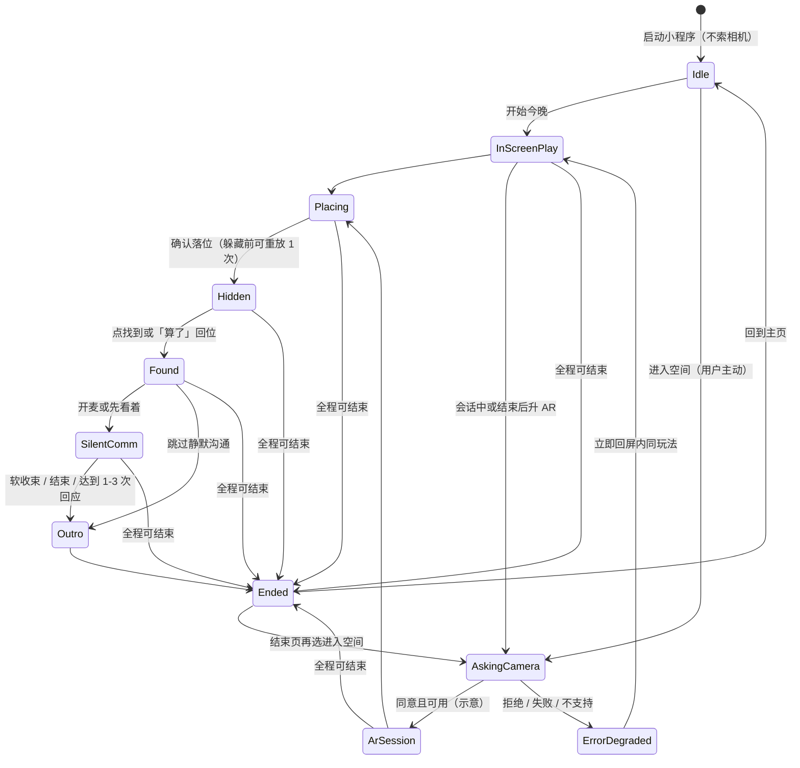

# 眠语 Demo 第一节点 · 信息架构与交互流程

- **作者**：CMQ-CIO-UX · 交互协同
- **写成时间**：2026-11-12 21:39（Asia/Shanghai）
- **本文件路径**：`/workspace/mianyu-demo/20261112-node1/ux-ia-flow.md`
- **交验收对象**：CMQ-CIO · 信息与数字化（第一次验收）
- **状态**：文档已第一次验收通过，不等于 Demo 完成
- **本轮性质**：交互设计文档。初版仅静态说明，**不**构成已上线、已上架或 Demo 已完成；**未**建 GitHub 仓；**未**改历史 Notion 页。静态原型由 CMQ-CIO-MiniProgram 按本文与 `ar-entry-path.md` 对照实现 `prototype/index.html`。HTML 展示稿 ≠ 可上架小程序 AR。
- **修订**：2026-11-12 21:41（Asia/Shanghai）补齐与同目录刚落盘的 [`architecture.md`](./architecture.md) 的对齐说明；不改他人文件。
- **修订**：2026-11-12（Asia/Shanghai）按 CIO 对静默沟通必演示段与影盏收尾示意的裁定修订。
- **修订**：2026-11-12（Asia/Shanghai）按 CIO 转达的影盏一次收尾锁定，将等待锁表述改为已锁定；不改写 2026-11-07 Notion 定稿。
- **修订**：2026-11-12（Asia/Shanghai）按第一次验收记录，将落位可重放与主页次 CTA 从「仍待验收说明」改为本节点原型默认。

配套文件：同目录 [`ar-entry-path.md`](./ar-entry-path.md)（AR 入口与操作路径）。两份文档的主路径、状态与文案红线保持一致。

---

## 0. 先读这条口径

| 对象 | 本轮实际状态 | 不得写成 |
| --- | --- | --- |
| 本文件与 `ar-entry-path.md` | 可打开的设计文档 | Demo 已完成 / 已上架 / 已真机验收 |
| 同目录 `prototype/index.html` | 由小程序岗交付的静态原型（写成时目录仍空） | 已接相机、已跑 VisionKit、已是可上架小程序 |
| 静默沟通 HTML 展示稿 | 2026-11-07 产品沟通材料 | 真机 AR 或已上线承诺 |
| 历史 V3 屏内原型 / 架构源文件 | 收口称已交付；当前工作区未找到源文件 | 现仍可打开的已实现工程 |

硬区分沿用 CFO 定稿原意：Bot 图文与 HTML ≠ 已交付可上架小程序 AR。

**现行口径**：以 2026-11-07 V3「小程序 AR 主、屏内必达降级、台卡后置」+ **2026-11-12 CIO 派单**为准。2026-10 选题包 / 项目时间计划书中的「网页优先 / WebAR / 台卡」为旧口径，不作为本轮页面结构依据。

**用词锁定**：首展 IP 写「**影盏**」（光影旅伴）。历史先通角色写「**霁霁**」。全文不用「影盎」「雲雲」「雾雾」。

---

## 1. 本轮锁定 vs 历史待复核

### 1.1 本轮 Demo 锁定（以 2026-11-12 CIO 派单为准）

1. 平台：微信小程序 AR；屏内 2D 同玩法为必达降级，共用一套状态机。
2. 低唤醒夜间主路径必须覆盖：**落位 → 躲猫猫 → 找到 → 静默沟通**。
3. 必须：**可关麦、可退出、无惊吓**。拒麦不影响躲猫猫闭环完成。
4. 首个展示 IP **只用影盏**。界面不出五选主路径。同壳换皮接口可预留，但本轮 Demo 不把五个 IP 全部塞进当前路径。
5. 静默沟通仅在找到或「算了」召唤回位之后（`after_find`）。`anytime_after_place` **本版不上线**。无 TTS。角色只动不说话。
6. 进入小程序**不先索相机**。先到影盏展示主页。对齐同目录 `ar-limitations.md`：推荐 **屏内先通 → 再升 AR → 失败或拒绝则降级回屏内同玩法**；升 AR 再问相机。也允许从主页直接进屏内（即主 CTA）。
7. 不含疗效 / 助眠承诺；姓名、房号不上传。
8. VisionKit **V1** 点按平面落位；零第三方 AR SDK。弱光 / 白桌 / 安卓漂移 / 相机审核等未验证项，不得写成保证。

### 1.2 必须写清的口径差异（不掩盖）

| # | 历史表述 | 本轮处理 |
| --- | --- | --- |
| D1 | 2026-11-07 CFO / V3 底稿写「先通霁霁、其余四皮 P1」 | **以本次派单为准**：本轮 Demo 默认角色是影盏，历史「先通霁霁」不作本轮默认。同壳换皮仍预留给其余 IP（含霁霁），本轮界面不做五选。该调整在盘点时的 Notion 眠语库中未找到已写入修订页，属「本派单调整」，不回改 11-07 底稿原文。 |
| D2 | CFO P0 表列「一次轻互动（霁霁关角灯）」，未把开麦静默沟通列为 P0 必达 | **以派单为准，且 CIO 已裁定**：本节点静态原型必演示该段（仅 `after_find`，可跳过、可关麦、无 TTS，拒麦不中断躲猫猫闭环）；不得写成已实现开麦听懂；不回改 CFO P0 原文。同目录 `ar-limitations.md` §2.1 写明「不把它写成已经进入本轮必做工程包」，`architecture.md` §0.2 亦将该层写入产品路径——二者是范围 / 结构表述，与「静态原型必演示该段」并存。 |
| D3 | 影盏收尾历史标「插片确认 vs 关光 待验证立项锁死」 | **已锁定**（2026-11-12，Asia/Shanghai，CIO 窗口）：采用组合——找到后可选「插片确认」（可跳过），结束为「关光」。本节点静态原型按该已锁定组合执行；界面不再标「收尾示意，待立项锁定」，可保留「本节点按用户已锁定的组合收尾」。不改写 2026-11-07 Notion 定稿。不要宣称该组合已被历史底稿锁死。 |
| D4 | 2026-10 选题包 / 计划书：网页优先、扫码 WebAR、台卡加分 | 旧口径。现行以 V3 + 本次派单为准。 |
| D5 | 架构收口：先进屏内再升 AR，升 AR 再问相机；CFO 还写过「先问相机或先屏内」 | 本轮不采用「启动即先问相机」。与 `ar-limitations.md` §2 对齐，见 §4 与 `ar-entry-path.md`。 |
| D6 | — | `anytime_after_place` 本版不上线；无 TTS。 |

### 1.3 本轮可执行默认

**CIO 已裁定**（2026-11-12，约 21:40 后，Asia/Shanghai）：

1. **影盏收尾组合**：**已锁定**（2026-11-12，Asia/Shanghai，CIO 窗口）。历史底稿与 `architecture.md` §4.3 均不代为裁定；用户选定组合如下。本节点静态原型按该已锁定组合执行；界面不再标「收尾示意，待立项锁定」，可保留「本节点按用户已锁定的组合收尾」。不改写 2026-11-07 Notion 定稿。  
   - 找到 / 回位后，可选一次「插片确认」作入口仪式（可跳过）。表现：暖光侧影坐正 1 拍 + 边缘呼吸光半拍。  
   - 静默沟通中的道具 / 晚安回应用「插片溶换」（内容包参数，非衣柜换装）：掌心 / 边缘光渐灭，插片轮廓溶换一次。  
   - 结束键默认为「关光」（掌心 / 边缘光渐灭）+ 文案「今晚就到这儿」软收束。  
   - 不要宣称该组合已被历史底稿或架构说明锁死。

**CIO 已裁定（本节点原型默认）**：

2. **落位可重放 1 次**：作为本节点原型默认保留，不写成历史定规。躲藏开始前允许重新点按平面改一次落点（初落 + 重放共 2 次）；躲藏开始后不可再改。
3. **主页双入口**：主 CTA「开始今晚」进屏内（对齐 AR 草稿「屏内先通」）；次 CTA「进入空间」保留。推荐仍是屏内先通，不强制必须先打完一局屏内才能升 AR；升 AR 仍须用户主动，相机仅用户主动点选后才问。不是启动即问相机。

---

## 2. 信息架构

本轮 Demo 只有「一个壳 + 影盏一皮」。不出现 IP 选择页、不出现五皮并行入口。换皮预留在壳层（内容包 / 偏移配置），不进入本轮界面主路径。

```
眠语小程序 Demo（本轮）
├── 影盏展示主页  Home
│   ├── 开始今晚          → 屏内会话（不索相机）
│   └── 进入空间          → 仅此时申请相机 → AR 会话或降级回屏内
└── 会话（屏内 / AR 共用状态机，仅模式不同）
    ├── 落位              Placing（可重放 1 次，本节点原型默认，不写成历史定规）
    ├── 躲猫猫            Hidden / Seeking
    ├── 找到或召唤回位    Found
    ├── 可选插片确认      Ritual（可跳过）
    ├── 静默沟通          SilentComm（可跳过 / 先看着 / 可关麦）
    ├── 收束              Outro（关光 + 今晚就到这儿）
    └── 结束              Ended（不自动再来一局）
系统层（非独立玩法）
├── 相机申请说明          AskingCamera（升 AR 才出现）
├── 降级提示              ErrorDegraded（短提示后回屏内，不卡死）
└── 常驻结束 / 退出       全程可离开
```

历史架构收口记载的页面切分是 `home → inscreen → ar 分包 → outro`（源文件当前工作区未找到，摘自收口摘要与 `ar-limitations.md`）。本轮信息架构与之对齐：主页、屏内会话、AR 会话（工程上计划独立分包）、收束 / 结束。静态原型可用同一套画面加「屏内 / 空间」模式切换来示意，不必真分包。

---

## 3. 画面清单（供静态原型照做）

下列是原型应能点到的画面，不是已上架页面。静态原型**示意**权限与降级，不接真机相机、不接真麦克风。文案以 §8 为准。

| ID | 画面 | 用户看见什么 | 主操作 | 常驻控件 | 模式 |
| --- | --- | --- | --- | --- | --- |
| S0 | 启动 | 极短品牌过渡，可省略 | 自动进入 S1 | 无 | — |
| S1 | 影盏展示主页 | 影盏坐 / 靠 / 蹲的暖琥珀侧影（禁飘浮、禁白纸扁剪影）；定位「光影旅伴」；说明可先在屏内完成一局 | 主 CTA「开始今晚」；次 CTA「进入空间」 | 结束 / 离开 | 未开会话 |
| S2 | 落位 | 屏内：暖雾底或模拟平面；AR：实时画面（原型仅示意）。提示轻点桌面 / 地面 / 墙边 | 点按平面；「换个位置」（若仍有重放次数）；「就在这儿」 | 结束 | 屏内或 AR |
| S3 | 已落位确认 | 影盏按坐 / 靠 / 蹲出现在落点，脚不离「地」，贴墙则靠墙意象，Y 轴不上浮 | 「就在这儿」开始躲藏；或重放 1 次 | 结束 | 同上 |
| S4 | 躲藏过渡 | 角色以预设偏移淡出 / 半透明意象藏起。无扑出、无惊吓音、无倒计时 | 自动进入 S5 | 结束 | 同上 |
| S5 | 寻找 | 轻点查找；剩余点找次数（最多 2 次）；「算了，回来吧」 | 点找或召唤 | 结束 | 同上 |
| S6 | 找到 / 回位 | 「找到了」或「它回来了」。可选「插片确认」入口仪式。可保留「本节点按用户已锁定的组合收尾」 | 「插片确认」（可跳过）；「开始静默沟通」；「先看着」；「今晚就到这儿」 | 结束 | 同上 |
| S7 | 开麦告知 | 显著说明：若开麦，语音只为触发角色动作，可关，非诊断、非医疗 | 「开麦试试看」；「先看着（不采集语音）」；「跳过」 | 结束 | 同上 |
| S8 | 静默沟通 | 影盏在场；状态「听着呢 / 先看着，未开麦 / 已关麦」。只做短肢体 / 光效，无 TTS、无咨询式长字幕 | 说话（仅开麦时示意）；关麦；结束 | **关麦** + 结束 | 同上 |
| S9 | 收束 | 关光（掌心 / 边缘光渐灭）+「今晚就到这儿」。可保留「本节点按用户已锁定的组合收尾」 | 自动或点按进入 S10 | 结束 | 同上 |
| S10 | 结束页 | 轻收束，不自动弹出「再来一局」。可回主页；若本局是屏内，可再选「进入空间」 | 「回到主页」；可选「进入空间」 | — | — |
| S11 | 相机说明 | 仅用户主动「进入空间」后出现。说明用途为把影盏放到平面上，娱乐互动，不是监测或医疗 | 「允许」（原型走成功分支示意）；「先在屏内继续」 | 结束 | 升 AR 过程 |
| S12 | 降级提示 | 短句「这次没能进入空间，我们在屏内继续」，不停留在错误页 | 自动或一点回到屏内同玩法 | 结束 | 失败回退 |

AR 与屏内不是两套玩法：S2–S10 共用画面结构，仅背景（模拟平面 vs 空间示意框）和是否曾走过 S11 不同。

---

## 4. 状态机

历史架构收口记载十态（源文件未找到，以下摘自收口摘要与 `ar-limitations.md`，**不是已实现接口名**）：

`Idle / InScreenPlay / AskingCamera / ArSession / Placing / Hidden / Found / Outro / Ended / ErrorDegraded`

本轮在「找到后」补一层产品状态 `SilentComm`（对应静默沟通架构收口的 `after_find`）。这是交互状态补齐，不是编造已有工程字段。`InScreenPlay` 与 `ArSession` 是呈现模式，包住同一套玩法状态。



关键不变量：

- 未到 `Found`（含「算了」回位）之前，不进入静默沟通，不申请麦克风。
- 未点「进入空间」之前，不申请相机。
- `ErrorDegraded` 不是终点，必须回到屏内同玩法。
- 任一玩法状态都可进入 `Ended`；结束页不自动连弹下一局。

---

## 5. 主路径与分支（逐步，供原型点调）

强度默认低：慢、短、弱光、静音。无倒计时、无排行、无惊吓扑出。

### 5.1 主路径（推荐，对齐 AR 草稿「屏内先通」）

1. 打开小程序 → **影盏展示主页**（S1）。不出现五选，不弹相机。
2. 点「开始今晚」→ 屏内落位（S2）。提示轻点桌面、地面或墙边。
3. 点按后影盏以坐 / 靠 / 蹲出现（S3）。若未开始躲藏，可「换个位置」**1 次**（本节点原型默认，不写成历史定规）。点「就在这儿」。
4. 躲藏过渡（S4）：按预设偏移藏起（淡出 / 半透明意象，不是真遮挡）。无扑出。
5. 寻找（S5）：点找 **≤2** 次；随时可用「算了，回来吧」召唤回位。无倒计时、无排行。
6. 找到或回位（S6）：可选「插片确认」入口仪式（可跳过）。
7. 进入静默沟通或跳过。若继续：先到开麦告知（S7）。可「开麦试试看」，可「先看着（不采集语音）」，可「跳过」直接收束。
8. 静默沟通（S8）：粗意图仅确认 / 靠近 / 闲聊 / 晚安 / 道具；影盏按 §7 差分回应。默认可 1–3 次短回应（单段约 1.5–4 秒）后软收束。常驻关麦；关麦立即停听。
9. 收束（S9）：关光 +「今晚就到这儿」。
10. 结束页（S10）：回到主页；或再选「进入空间」（此时才走相机说明）。

召唤跳过找藏的用户，回位后同样可进静默沟通，规则与找到相同。

### 5.2 主要分支

| 分支 | 行为 | 结果 |
| --- | --- | --- |
| 主页直接「进入空间」 | 先走 S11 相机说明，不把权限挡在启动时 | 成功则 AR 模式走同一套 S2–S10；失败走 S12 → 屏内同玩法 |
| 屏内局中或结束页升 AR | 同样只在此时问相机 | 成功可开新的空间局或（原型示意）带入已结束回主路径；失败留在 / 回到屏内 |
| 落位重放 | 躲藏前改一次落点 | 第二次确认后开始躲藏 |
| 点找未中（第 1 次） | 轻反馈，剩余 1 次 | 仍在 S5，无惩罚、无计时 |
| 点找未中（第 2 次）或用户「算了」 | 召唤回位 | 进入 S6，视为回位，可继续沟通或收束 |
| 跳过插片确认 | 不播放入口仪式 | 仍可进 S7 或直接收束 |
| 拒绝开麦 / 选「先看着」 / 跳过沟通 | 不采集语音 | 躲猫猫已完成；先看着可静坐在场；跳过则进收束 |
| 沟通中关麦 | 立即停听 | 角色保持在场，可继续先看着或结束 |
| 全程结束 / 离开 | 进入收束或直接结束页 | 不拦截、不挽留弹窗轰炸 |
| AR 过程中弱光丢平面 / 会话失败 | 见 `ar-entry-path.md` | S12 后回屏内同玩法，不另开第二种玩法 |

### 5.3 本版不做（不要做成可点功能）

真家具 / 窗帘遮挡、人体跟踪、暗房满血 6DoF、台卡 Marker 必达、疗效 / 助眠 / 睡眠评分 / 心理咨询、AI 多轮闲聊卖点、五皮同开、`anytime_after_place`、TTS 对白、倒计时闯关、惊吓、排行、姓名 / 房号上传。

---

## 6. 全局控件与权限时机

| 控件 / 权限 | 出现时机 | 规则 |
| --- | --- | --- |
| 结束 / 离开 | S1 起常驻（结束页除外，结束页本身就是离开后状态） | 随时可走；文案用「结束」或「今晚就到这儿」，不用恐吓或挽留 |
| 关麦 | 仅 S8 静默沟通段常驻 | 关后立即停听；可保持「先看着」 |
| 换个位置 | 仅 S2–S3，且尚未开始躲藏 | 本节点原型默认 1 次，不写成历史定规 |
| 算了，回来吧 | 仅 S5 | 召唤回位，不算失败 |
| 相机 | 仅用户主动「进入空间」之后（S11） | 启动、主页浏览、屏内开局都不问。拒绝 / 失败走屏内。用途声明为娱乐互动，不得写成监测或医疗 |
| 麦克风 | 仅 S7 用户选择「开麦试试看」之后 | 「先看着」与跳过均不采集。拒绝不影响躲猫猫完成 |
| 姓名 / 房号 | 任何画面都不采集、不上传 | — |

默认静音：无背景音乐强起、无惊吓音、无角色语音（无 TTS）。

---

## 7. 影盏主路径差分（本轮唯一展示皮）

来源：2026-11-07 静默沟通展示稿。本轮界面只表现影盏；下表供原型做对，不因此展开五选。

**定位**：光影旅伴；默认坐 / 靠 / 蹲；暖琥珀内透光侧影 + 插片内容。禁止飘浮，禁止白纸扁剪影。插片 = 内容包（非衣柜换装）。

| 节点 | 影盏表现 |
| --- | --- |
| 落位 | 按点击平面坐下 / 靠下 / 蹲下；若点墙边，贴墙意象坐靠；脚不离「地」；Y 轴不上浮 |
| 躲藏 | 沿墙或平面意象做预设偏移后淡出 / 半透明，不飞起、不扑出 |
| 找到后入口仪式（可选；本节点按用户已锁定的组合收尾） | 「插片确认」：暖光侧影坐正 1 拍 + 边缘呼吸光半拍 |
| 静默沟通 · 确认 | 暖光侧影坐正 1 拍 + 边缘呼吸光半拍 |
| 静默沟通 · 靠近 | 坐姿贴墙平移 10–15cm，脚不离「地」；Y 轴不上浮 |
| 静默沟通 · 闲聊 | 当前插片镂空眼明暗交替 2 次 |
| 静默沟通 · 晚安 / 道具 | 掌心 / 边缘光渐灭；插片轮廓溶换一次（改插片参数，不是表情包鬼畜） |
| 结束关光（本节点按用户已锁定的组合收尾） | 掌心 / 边缘光渐灭 +「今晚就到这儿」 |

低唤醒：光一拍即停；位移慢而短；换的是插片参数。粗意图仅确认 / 靠近 / 闲聊 / 晚安 / 道具。不输出焦虑 / 抑郁 / 失眠等标签。不追人脸、不做追光秀。

同壳换皮：壳层可预留「内容包 + 藏点偏移 + 一次收尾」接口，供日后接霁霁 / 守绒 / 泊泊 / 阑岚。本轮原型界面不出现这些角色的选择或并列入口。

---

## 8. 文案与禁用词

对外可用：「娱乐互动 · 夜间陪伴」。展示稿金句「陪你过夜」若使用，**必须同屏或同节**写明：这是过夜仪式感与角色互动，不是医疗或心理咨询产品；不构成疗效承诺。

开麦告知建议句（可微调，不可改成监测 / 诊断）：

> 如果打开麦克风，影盏会用动作回应你说的话。语音只用来触发角色动作，可以随时关掉。这是娱乐互动，不是监测，也不是咨询。

相机说明建议句：

> 进入空间需要使用相机，把影盏放到你面前的桌面、地面或墙边。这是娱乐互动，不是监测或医疗。也可以先在屏内继续。

**禁用**（界面、提示、结束页、注释均不可出现）：助眠、疗效、安神、心理咨询、情绪诊断、读心、保证平静入睡、AI 陪伴治疗，以及「守护你入睡」类承诺。也不要把「听得懂」写成读心或情绪分析。

可以这样说：听得懂你说的话；肢体 / 轨迹轻轻回应；静默沟通；可关麦；娱乐互动。

---

## 9. 与 Architecture / AR 草稿的对齐

落盘前第一次 `ls` 时，同目录已有 [`ar-limitations.md`](./ar-limitations.md)，尚无架构说明。两份 UX 文档写出后，同目录出现 [`architecture.md`](./architecture.md)（CMQ-CIO-Architecture，写成时间 2026-11-12 21:40 Asia/Shanghai）。本小节已按该稿补齐对齐，未覆盖他人文件。

- **[`ar-limitations.md`](./ar-limitations.md)**（2026-11-12 21:37 Asia/Shanghai）。已对齐：屏内先通再升 AR、升 AR 再问相机、失败回屏内同玩法、十态名称只作收口摘述、VisionKit V1、零第三方 SDK、真遮挡 / 人体跟随 / 暗房满血 6DoF 本版不做、未验证项不得写成保证、结束页不自动再来一局、本文件不是已完成 AR。差异见 §1.2 D2：AR 草稿不把静默沟通写成必做工程包；本文件按派单把该层写入交互路径（可跳过）。
- **[`architecture.md`](./architecture.md)**。已对齐：当前 Demo 只接影盏、界面无五选、同壳换皮预留（架构稿使用设计标识 `ipId = yingzhan`，本文沿用该称呼，不另编接口字段）；入口先进屏内再升 AR，失败回屏内同玩法；主路径落位 → 躲 → 找到 → 静默沟通（可跳过、可关麦）→ 可随时结束；`after_find` 默认、`anytime_after_place` 不上线、无 TTS；十态为收口摘述而非已实现接口；不卡权限页；结束页不自动再来一局；真遮挡 / 人体跟随 / 暗房满血 6DoF 本版不做。静默沟通：架构稿同样写入产品路径；**CIO 已裁定**本节点静态原型必演示该段（仅 `after_find`，可跳过、可关麦、无 TTS，拒麦不中断躲猫猫闭环），不得写成已实现开麦听懂，不回改 CFO P0 原文。影盏收尾：**已锁定**（2026-11-12，Asia/Shanghai，CIO 窗口；架构稿 §4.3 **不代为锁死**「插片确认 vs 关光」）：采用组合——找到后可选「插片确认」（可跳过），结束为「关光」。本节点静态原型按该已锁定组合执行；界面不再标「收尾示意，待立项锁定」，可保留「本节点按用户已锁定的组合收尾」。不改写 2026-11-07 Notion 定稿。入口微调：架构稿推荐「进入后先走屏内，再由用户升 AR」；本文主 CTA 与之相同，另在主页保留次 CTA「进入空间」（仍是用户主动才问相机）。**CIO 已裁定（本节点原型默认）**：推荐仍是屏内先通，不强制必须先打完一局屏内才能升 AR；升 AR 仍须用户主动，相机仅用户主动点选后才问。

---

## 10. 来源

| 来源 | 位置 | 用法 |
| --- | --- | --- |
| 2026-11-12 CIO 派单 | 本节点目录说明与上级转达 | 首展影盏、路径必含静默沟通、可关麦可退出无惊吓、只写设计文档 |
| 架构盘点 | `/workspace/mianyu-architecture-inventory.md` | 口径分层、CFO 摘述、缺口与用词锁定；本轮未另抓 CFO 页全文 |
| CFO 底稿（定稿，2026-11-07） | https://app.notion.com/p/411340bcc396814a9b16de9c7b11419c | 经盘点摘述引用，不编造未读原文 |
| AR 限制草稿 | `/workspace/mianyu-demo/20261112-node1/ar-limitations.md` | 入口顺序与限制清单对齐 |
| 产品技术架构说明 | `/workspace/mianyu-demo/20261112-node1/architecture.md` | 只接影盏、同壳预留、入口与状态机、收尾不代锁；落盘后补对齐 |
| 静默沟通展示稿 | `/workspace/mianyu-v4/user-attachments/showcase-silent-comm/showcase-silent-comm/index.html` | 主路径、可关麦、影盏差分、文案红线；自述不构成已上线承诺 |
| 小程序 AR MVP 架构收口 | https://app.notion.com/p/411340bcc39681b186d7ef3d1661acaf | 屏内先通、十态、失败走屏内；源 md 未找到 |
| 静默沟通小程序架构收口 | https://app.notion.com/p/411340bcc396810584ebe3a1638a3783 | `after_find` 默认；`anytime_after_place` 不上线 |
| V3 UIUX / 静默沟通 UIUX / 全案收口 | https://app.notion.com/p/411340bcc39681f5bc0dd18842d5d5d5 、 https://app.notion.com/p/411340bcc396812895dddcf60fe4894b 、 https://app.notion.com/p/411340bcc39681029a4ffc0f6a54c64b | 只读复用索引；完整线框源文件当前工作区未找到，细节以展示稿 + 盘点摘述为准 |
| V2 UIUX 低唤醒 | https://app.notion.com/p/411340bcc3968192947df69f04968082 | 低唤醒原则的上游输入；现行以 V3 + 派单为准 |

本文件到此为止，请 CIO 做第一次验收。不越级请用户拍板。不把本文当成 Demo 完成。

---

## CIO 第一次验收（2026-11-12，Asia/Shanghai）

CMQ-CIO · 信息与数字化第一次验收通过。这是文档验收通过，不等于 Demo 完成。未改 Notion。裁定如下：

1. 静默沟通是本节点静态原型必演示段：仅 `after_find`，可跳过、可关麦、无 TTS，拒麦不中断躲猫猫闭环；不得写成已实现开麦听懂；不回改 CFO P0。
2. 影盏收尾：验收当时产品层尚未锁死；其后已锁定，见文末锁定记录。本节点静态原型按已锁定组合执行（找到后可选「插片确认」（可跳过），结束时「关光」）；界面不再标「收尾示意，待立项锁定」。不改写 2026-11-07 Notion 定稿。
3. 躲藏前落位可重放 1 次：作为本节点原型默认保留，不写成历史定规。
4. 主页保留次 CTA「进入空间」：推荐仍是屏内先通，不强制必须先打完一局屏内才能升 AR；升 AR 仍须用户主动，启动不问相机。

## 影盏一次收尾锁定（2026-11-12，Asia/Shanghai）

CMQ-CIO · 信息与数字化转达：用户于 2026-11-12（Asia/Shanghai）在 CIO 窗口选定：采用组合——找到后可选「插片确认」（可跳过），结束时「关光」。本节点静态原型按该已锁定组合执行；界面不再标「收尾示意，待立项锁定」，可保留「本节点按用户已锁定的组合收尾」。不改写 2026-11-07 Notion 定稿。这是收尾组合锁定，不等于 Demo 完成。
